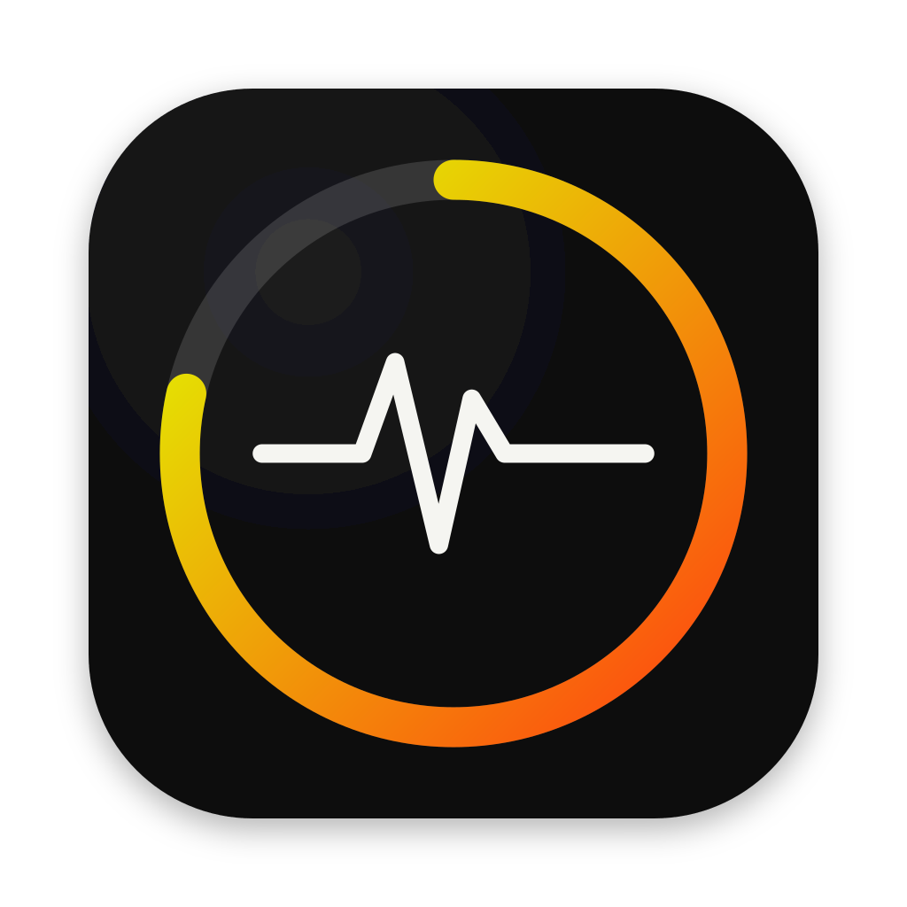

# Pulse Companion

提交 Codex 任务后，可以切到别的窗口继续工作。Pulse Companion 让你看到剩余额度、关注正在执行的对话，并在任务完成或需要处理时提醒你。点一下任务，就能回到对应的 Codex 对话。

**[下载安装](#下载安装) · [支持哪些应用](#支持哪些应用) · [使用与排障](docs/install.md) · [更新记录](CHANGELOG.md)**

## 下载安装

**[1.2.0-rc.1 公开预览](https://github.com/Yueyuyu/pulse-companion/releases/tag/v1.2.0-rc.1)**：请在下表选你的系统。稳定版 `v1.1.0` 仍然保留；GitHub 自带的 `Source code (zip)` 是源码，不是安装包。

| 你的电脑 | 安装包格式 | 安装后在哪里 |
| --- | --- | --- |
| Windows 10/11 x64 | [下载 Windows 安装程序（.exe）](https://github.com/Yueyuyu/pulse-companion/releases/download/v1.2.0-rc.1/Pulse-Companion-1.2.0-Windows-x64-Setup.exe) | 桌面浮条和系统托盘 |
| Mac，macOS 13 及以上，Apple 芯片或 Intel | [下载 Mac 安装镜像（.dmg）](https://github.com/Yueyuyu/pulse-companion/releases/download/v1.2.0-rc.1/Pulse-Companion-1.2.0-macOS-universal.dmg) | 菜单栏中的 Pulse Companion |

- **Windows：**运行 EXE，按当前用户安装。公开版用应用品牌图标，不包含本机专用的动态机器人；不需要克隆源码、安装 Node.js 或运行脚本。
- **Mac：**打开 DMG，把 **Pulse Companion.app** 拖入「应用程序」，再从那里启动。它是本项目自己的 macOS 原生应用，不是上游 Pulse 的重新打包。
- **首次打开前：**Windows EXE 未做发行签名；Mac 应用仅有临时签名，没有 Developer ID 签名或苹果公证。系统可能警告或阻止打开。可用[本版 SHA-256 清单](https://github.com/Yueyuyu/pulse-companion/releases/download/v1.2.0-rc.1/SHA256SUMS.txt)核对文件；如设备要求可信签名，请等待签名版本，不要关闭防护。

## 第一次使用

1. 正常打开并登录 Codex。Companion 使用已有的只读接口；没有可用数据时会标为不可用，不用示例百分比填充。
2. Windows 点桌面浮条，Mac 点菜单栏图标，查看额度和最近任务。选择星标，最多可保留 5 个重点关注的对话。
3. 切到其他工作。任务完成或需要处理时会提醒；在面板里点任务即可跳回 Codex。首次连接不会把历史任务全部当作新完成的任务通知。

*上图说明 Windows 的完成通知；不是 Mac 菜单栏或桌面浮条截图。*

## 支持哪些应用

| 应用 | Windows 品牌版 | macOS 首版 |
| --- | --- | --- |
| Codex | 周额度、任务列表、重点关注、完成与需处理提醒、跳转对话 | 周额度、任务列表、重点关注、任务提醒、跳转对话 |
| Cursor、Claude、Grok Bot | 经你在官方页面单独授权后查询对应账户的额度，不从桌面应用提取登录令牌；能否读取取决于账户和上游接口 | 未接入 |
| Antigravity | 通过已安装、已登录的官方 agy CLI 查询模型组与周期额度；没有可用 CLI 时显示不可用 | 未接入 |
| ZCode、Kimi、豆包工作、WorkBuddy | 可识别桌面窗口；未接入额度与任务 | 未接入 |

Windows 支持拖动、展开和贴边，自动贴边默认关闭。应用窗口关闭后对应浮条项隐藏。只有 Codex 接入了任务能力；打开其他应用不代表有任务在运行。[额度来源、账户选择与能力边界 →](docs/account-authorization.md)

## 数据和更新

Companion 不修改或注入 Codex，不创建任务、不发送模型请求，查询本身不消耗模型额度。关注记录保存在当前用户本机；Windows 和 Mac 各自保存，不经本项目的服务器同步。Codex 可以独立更新；上游接口变化时，Companion 可能需要跟进适配。

## 文档与开发

- [安装、校验、升级与卸载](docs/install.md) · [Windows 后台运行](docs/pulse-background.md) · [故障排查](docs/troubleshooting.md)
- [从源码构建本机机器人版](docs/new-computer-setup.md) · [Windows 宿主与维护边界](docs/architecture.md) · [验收与发布流程](.github/CI.md)
- [旧版 Quiet Workspace 图集与回退](docs/legacy-quiet-workspace.md)：`v1.1.0` 的左下角胶囊和任务灯不是当前默认界面。

Pulse Companion（原 Codex Desktop Companion）是独立社区项目，不是 OpenAI 或 [上游 Pulse](https://github.com/qunqin24/Pulse) 的官方发行版。Windows 界面来自配套的 [UI Design Lab](https://github.com/Yueyuyu/ui-design-lab/tree/051ff68cabfd52b3757429b0dd13d5aa7e8e0a9e/systems/pulse-desktop)；[第三方来源和分发边界](https://github.com/Yueyuyu/ui-design-lab/blob/051ff68cabfd52b3757429b0dd13d5aa7e8e0a9e/systems/pulse-desktop/UPSTREAM.md) 区分了可公开的品牌资产与不得随包分发的机器人资源。
